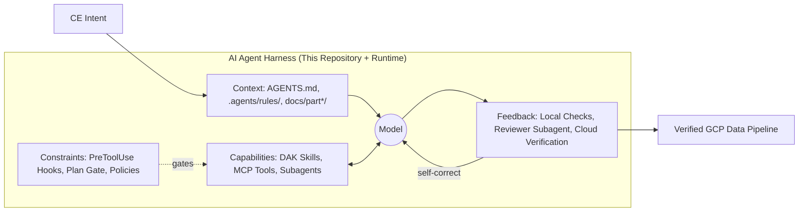

# L400 Agentic Data Engineering — Student Workspace

Welcome to the **L400 Agentic Data Engineering in Google Cloud** hands-on workspace. This repository is structured as an **AI Agent Harness** for **Intent-Driven & Spec-Driven Data Engineering** across all three parts of the workshop.

---

## 🛠️ Prerequisites

Before starting the workshop labs, ensure you have:
- An active **Argolis** account.
- A provisioned **Cloudtop** machine.
- Completed the developer workstation setup instructions at **[go/cloudtop-dev-machine](http://go/cloudtop-dev-machine)**.

---

## 🎯 Workshop Modules & Core Learning Objectives

### Part 1 — The Troubleshoot (Spark & Lightning Engine RCA)
Diagnose and remediate PySpark execution bottlenecks on Dataproc Serverless Runtime `2.3` Lightning Engine (Gluten/Velox).
- **Core Learning Objectives:**
  - Diagnose native C++ vectorization fallbacks (`Gluten` / `Velox`) on Dataproc Serverless Runtime `2.3` using Spark Event Logs and physical execution plans (`df.explain(True)`).
  - Refactor row-by-row Python UDF anti-patterns into vectorized native Spark SQL expressions (`pyspark.sql.functions`) and verify end-to-end execution plan and output parity.
  - Codify Spark vectorization and physical plan verification rules into `.agents/rules/spark_standards.md` so the AI agent enforces them automatically.

### Part 2 — The Build (Qualification & Benchmark)
Qualify a 1,200-job Spark estate for Native Query Engine (NQE) acceleration, model fleet TCO/ROI, and orchestrate an A/B benchmark in Cloud Composer 3 (Apache Airflow).
- **Core Learning Objectives:**
  - Evaluate and qualify a 1,200-job enterprise Spark estate for Native Query Engine (Lightning Engine) acceleration and model fleet-wide TCO/ROI savings (`AppsRecommendedForBoost.tsv` and `roi_summary.json`).
  - Architect and orchestrate an automated A/B performance benchmark DAG with a deceleration release-gate sensor in Cloud Composer 3 comparing standard Dataproc vs. Lightning Engine.
  - Extend the AI harness with NQE qualification thresholds, Airflow benchmark DAG standards, and custom subagent review checks (`.agents/rules/spark_standards.md` and `.agents/agents/l400-code-reviewer.md`).

### Part 3 — The Build (Agentic Medallion Lakehouse)
Architect, build, govern, and reconcile an end-to-end payment-fraud Medallion Lakehouse across Cloud Storage, Google Lakehouse (Apache Iceberg V2), Dataproc Serverless Spark (`2.3` + NQE), BigQuery, `dbt-bigquery`, Dataplex Knowledge Catalog, and Cloud Composer 3.
- **Core Learning Objectives:**
  - Practice the **8-Step Spec-Driven Data Engineering Lifecycle** by authoring `docs/part3/DISCOVERY.md` (Step 01) $\rightarrow$ `docs/part3/EDA.md` (Step 02) $\rightarrow$ `docs/part3/SPEC.md` (Step 03) from un-spoiled templates before generating pipeline code.
  - Build a multi-engine Bronze $\rightarrow$ Silver $\rightarrow$ Gold Medallion Lakehouse using Apache Iceberg V2 REST Catalogs with zero-trust credential vending, Dataproc Serverless Spark (`2.3` + NQE), BigQuery external tables, and `dbt-bigquery`.
  - Enforce enterprise PII governance (dynamic data masking in Bronze; cryptographic SHA-256 hashing and physical PII column removal in Silver), Dataplex Knowledge Catalog aspects, Auto Data Quality rules, Cloud Composer 3 orchestration with OpenLineage, and `0.00`-variance cross-layer financial reconciliation.

---

## 🧩 AI Harness Engineering Architecture

In this workshop, **your repository is the harness** (`Agent = Model + Harness`). Rather than relying on ad-hoc *vibe coding*, this workspace surrounds the foundation model with structured context, domain capabilities, deterministic guardrails, and closed-loop verification.

> 📖 **Deep Dive & Repo Tour:** Open [`docs/intro/harness-engineering-deck.md`](docs/intro/harness-engineering-deck.md) for the complete **AI & Harness Engineering** slide blueprint and clickable repository tour.



### The Four Harness Layers

| Harness Layer | Purpose | Repository Implementation |
| :--- | :--- | :--- |
| **1. Context** *(What the agent knows)* | Keeps always-loaded instructions small and routes to domain depth via progressive disclosure | • **Single Constitution:** [`AGENTS.md`](AGENTS.md) (symlinked to `GEMINI.md`, `CLAUDE.md`, `.cursorrules`, and `.clinerules` for cross-IDE portability)<br>• **Progressive-Disclosure Rules (`.agents/rules/`):** 3 `always_on` rules (`always_create_plan.md`, `zero_secrets_policy.md`, `lab_governance.md`) + 4 on-demand `model_decision` domain rules (`spark_standards.md`, `lakehouse_standards.md`, `bigquery_dbt_standards.md`, `agent_skills_standards.md`)<br>• **Durable Specs:** `docs/part1/`, `docs/part2/`, and `docs/part3/{DISCOVERY,EDA,SPEC}.md` |
| **2. Capabilities** *(What the agent can do)* | Provides packaged procedural know-how, typed cloud inspection, and isolated review contexts | • **Data Agent Kit (DAK) Skills:** Pre-installed runtime skills (`google-cloud-auth-verification`, `discovering-gcp-data-assets`, `gcp-spark`, `schema-mapping`, `data-autocleaning`, `bigquery`, `bigquery-sql`, `dbt-bigquery`, `gcp-managed-airflow-dag-authoring`, `gcp-composer-troubleshooting`, `enforcing-resource-attribution`, `managing-python-dependencies`, `accidental-data-loss-prevention`)<br>• **Workspace Skills:** [`.agents/skills/skill-creator/`](.agents/skills/skill-creator/SKILL.md) (skill authoring, benchmarking & held-out evaluation toolkit)<br>• **Typed GCP MCP Servers:** `dak_bigquery`, `dak_dataproc`, `dak_serverless-spark`, `datacloud_gcs_remote`, `datacloud_knowledge_catalog_remote`<br>• **Read-Only Subagent:** [`.agents/agents/l400-code-reviewer.md`](.agents/agents/l400-code-reviewer.md) (`read_file`, `view_file`, `code_search` allowlist) |
| **3. Constraints** *(What the agent must never do)* | Pairs probabilistic guidance with deterministic enforcement at the tool boundary | • **Deterministic `PreToolUse` Hook:** `.agents/hooks.json` + `.agents/hooks/guardrails.py` enforce the **Evaluator Blind Spot** outside the model<br>• **Human Approval Gate:** Mandatory 6-Section Execution Plan ([`always_create_plan.md`](.agents/rules/always_create_plan.md)) before any file edit or cloud job<br>• **Zero Secrets & Data Safety:** [`zero_secrets_policy.md`](.agents/rules/zero_secrets_policy.md) backed by [`.gitignore`](.gitignore) and `accidental-data-loss-prevention` |
| **4. Feedback** *(How the agent knows it is right)* | Prevents premature completion and reward hacking via evidence-based verification | • **Definition of Done (`AGENTS.md` §6):** Local syntax compilation (`py_compile` / `dbt compile`) $\rightarrow$ `l400-code-reviewer` audit $\rightarrow$ live GCP job state (`DONE` / `SUCCEEDED`) & output table verification (up to 3 self-correction attempts)<br>• **Held-Out Verifiers:** `lab-evaluation-verifier/` executed directly by the CE |

### Complete the Harness: 9 Guided `TODO (CE)` Checkpoints

During the labs, you don't just prompt the agent—you **complete the harness** by filling in 9 guided `TODO (CE)` blocks across 4 files so the agent and code reviewer enforce your architectural standards:

| Harness File | Lab Part(s) | `TODO (CE)` Blocks | Standards You Codify |
| :--- | :---: | :---: | :--- |
| [`.agents/rules/spark_standards.md`](.agents/rules/spark_standards.md) | Parts 1, 2, 3 | 3 | Python UDF vs. native Spark SQL vectorization & physical plan checks (Part 1); NQE qualification thresholds & Airflow A/B DAG standards (Part 2); Bronze ingestion & Silver data-hygiene rules (Part 3) |
| [`.agents/rules/lakehouse_standards.md`](.agents/rules/lakehouse_standards.md) | Part 3 | 2 | Google Lakehouse / Iceberg V2 REST catalog session properties & table write modes; PII masking/dropping, Knowledge Catalog aspects & Auto DQ rules |
| [`.agents/rules/bigquery_dbt_standards.md`](.agents/rules/bigquery_dbt_standards.md) | Part 3 | 2 | BigQuery external tables, 1:N child pre-aggregation CTEs, partitioning/clustering & dbt conventions; Silver-vs-Gold `0.00`-variance reconciliation checks |
| [`.agents/agents/l400-code-reviewer.md`](.agents/agents/l400-code-reviewer.md) | Parts 1–3 | 2 | Mandatory Spark/NQE anti-patterns (Parts 1–2) and Medallion Lakehouse/BigQuery/dbt audit checks (Part 3) that must fail code review |

---

## 📁 Workspace Structure

```text
.
├── AGENTS.md                            # Primary AI Agent Constitution & Router
├── GEMINI.md                            # Symlink -> AGENTS.md (Gemini CLI / Jetski)
├── CLAUDE.md                            # Symlink -> AGENTS.md (Claude Code)
├── .cursorrules                         # Symlink -> AGENTS.md (Cursor)
├── .clinerules                          # Symlink -> AGENTS.md (Cline)
├── .skills                              # Symlink -> .agents/skills
├── .env.example                         # Example local environment variables template (real .env is gitignored)
├── .gitignore                           # Zero-secrets, virtualenv, Terraform & runtime artifact exclusions
├── LICENSE                              # Repository license
├── README.md                            # Student workspace onboarding & AI Harness guide
├── proxy.py                             # Protected lab infrastructure (off-limits to the agent)
├── .github/
│   ├── dependabot.yml                   # Automated GitHub Actions dependency updates
│   └── workflows/
│       └── ci.yml                       # CI workflow with timeout & concurrency guardrails
├── .agents/
│   ├── agents/
│   │   └── l400-code-reviewer.md        # Custom read-only subagent for L400 architectural code reviews (complete TODOs)
│   ├── hooks/
│   │   └── guardrails.py                # Deterministic PreToolUse guardrail script
│   ├── hooks.json                       # Lifecycle hook configuration
│   ├── rules/
│   │   ├── always_create_plan.md        # [always_on] Enforces structured 6-section execution plans
│   │   ├── zero_secrets_policy.md       # [always_on] Enforces strict credential & PII Git hygiene
│   │   ├── lab_governance.md            # [always_on] Enforces lab pacing, blind spots, and directory layout
│   │   ├── spark_standards.md           # [model_decision] Spark, Dataproc & Lightning Engine rules (complete TODOs)
│   │   ├── lakehouse_standards.md       # [model_decision] Google Lakehouse, Iceberg V2 & Governance rules (complete TODOs)
│   │   ├── bigquery_dbt_standards.md    # [model_decision] BigQuery SQL & dbt modeling rules (complete TODOs)
│   │   └── agent_skills_standards.md    # [model_decision] DAK skills, MCP tools & Python environment rules
│   └── skills/
│       └── skill-creator/               # Skill authoring, benchmarking & evaluation toolkit
├── docs/
│   ├── intro/
│   │   └── harness-engineering-deck.md  # AI & Harness Engineering slide blueprint & clickable repo tour
│   ├── part1/                           # Part 1 reports, physical plans & RCA deliverables
│   ├── part2/                           # Part 2 qualification TSV, ROI JSON & benchmark notes
│   └── part3/                           # Part 3 8-Step Spec-Driven Planning Docs & Un-Spoiled Templates
│       ├── DISCOVERY-template.md        # Step 01 skeleton (§0–§16) -> copy/fill to create DISCOVERY.md
│       ├── EDA-template.md              # Step 02 skeleton (§0–§10) -> copy/fill to create EDA.md
│       └── SPEC-template.md             # Step 03 skeleton (§0–§9)  -> copy/fill to create SPEC.md
├── lab-packs/                           # Self-contained lab environment deployment bundles
│   ├── deploy-all-labs.sh               # Master sequential provisioner for Parts 1, 2 & 3
│   ├── part1-troubleshoot.zip           # Part 1 lab infrastructure bundle
│   ├── part2-qualification.zip          # Part 2 lab infrastructure bundle
│   └── part3-medallion.zip              # Part 3 lab infrastructure bundle
├── lab-evaluation-verifier/             # Automated Pass/Fail CLI evaluators (setup/, part1/, part2/, part3/)
└── src/
    ├── part1/                           # Part 1 remediated PySpark & validation scripts
    ├── part2/                           # Part 2 qualification scripts & Cloud Composer DAGs
    └── part3/                           # Part 3 Medallion codebase (matches SPEC.md §0.3)
        ├── scripts/                     # 01_bronze_ingest.py, 02_silver_transform.py,
        │                                # register_bq_external_tables.py, apply_kc_governance.py
        ├── dbt_project/                 # dbt_project.yml, profiles.yml, models/gold_fraud_features.sql
        ├── sql/                         # gold_fraud_features.sql, reconcile_silver_vs_gold.sql
        └── dags/                        # medallion_lakehouse_dag.py (+ src/part3/dq_rules.yaml)
```

---

## 🚀 How to Work with Your AI Agent

1. **Follow the Lab Portal Instructions:** Each lab checkpoint on the workshop portal defines the business problem and verification goals.
2. **Practice Spec-Driven & Context Engineering (`.agents/rules/` & `docs/part3/`):**
   - Inspect and complete the domain rule files inside `.agents/rules/` (`spark_standards.md`, `lakehouse_standards.md`, `bigquery_dbt_standards.md`).
   - In **Part 3**, collaborate with your agent to generate `docs/part3/DISCOVERY.md`, `docs/part3/EDA.md`, and `docs/part3/SPEC.md` directly from the included `*-template.md` skeletons, then validate each document with the **Planning Document Review & AI Coaching** tool on `/part3` before generating pipeline code!
3. **Delegate Code Reviews to Your Custom Subagent (`.agents/agents/l400-code-reviewer.md`):**
   - This workspace includes a specialized, read-only custom subagent at `.agents/agents/l400-code-reviewer.md`.
   - Complete the `<!-- TODO (CE): ... -->` checklist inside `.agents/agents/l400-code-reviewer.md`, and ask your main agent to invoke the `l400-code-reviewer` subagent (especially during **Part 3 Step 05: Review the Code and Assets Generated**) to audit your PySpark, SQL, dbt, and Airflow code in an isolated context window!
4. **Review the 6-Section Execution Plan:**
   - Before writing code or submitting cloud jobs, your agent will ask clarifying questions and present a structured 6-section plan (*Summary of the Plan*, *What You Want to Do*, *How You Want to Do It*, *Files Expected to Change or Create*, *Regression Risk Analysis*, *Clarification Questions*). Review and approve the plan before execution.

---

## ⚡ Pro Tips: Native Antigravity & Jetski Superpowers

Take advantage of these built-in Antigravity & Jetski capabilities during the workshop:
- **`/grill-me` (Interactive Design Interview):** Type `/grill-me` when designing your `DISCOVERY.md`, `SPEC.md`, or `.agents/rules/` standards to have the agent interview you and uncover edge cases before writing code.
- **`/goal` (Autonomous Spec Loop in Step 04):** Once `docs/part3/SPEC.md` passes review, consider using `/goal` in Step 04 so your agent loops autonomously over every deliverable in `SPEC.md` until verified.
- **`/compact` (Context Window Reset Between Labs):** Run `/compact` when transitioning from **Part 1 $\rightarrow$ Part 2** or **Part 2 $\rightarrow$ Part 3** to summarize and compact your conversation history so previous logs don't consume your context window.
- **`/learn` (Persist New Rules Automatically):** Whenever you correct the agent or discover a crucial platform behavior, type `/learn` so the agent codifies that lesson into your workspace rules or skills.
- **Interactive Visualizations (`generative_ui`):** Ask your agent to use the `generative_ui` skill to render visual Spark physical plan comparisons, Medallion lineage diagrams, or financial reconciliation dashboards directly inside the chat pane.
