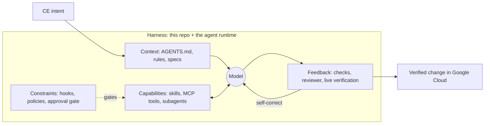
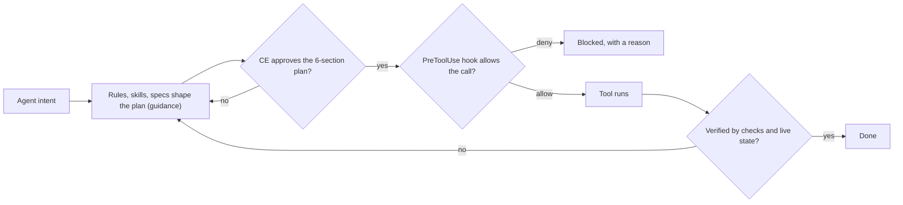
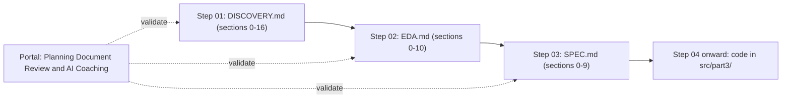
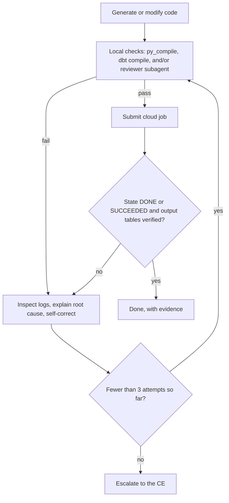
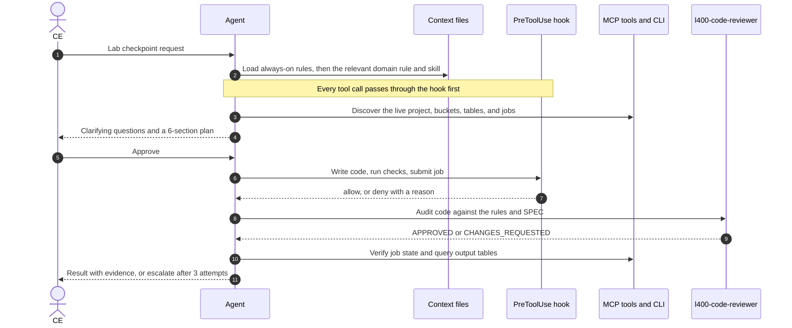
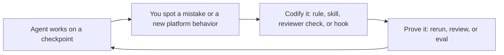

> **Presenter preface (not a slide)**
>
> - **Purpose:** introduce the L400 Agentic Data Engineering lab by touring this repository through an AI / Harness Engineering lens.
> - **Format:** slides are separated by `---`; each `##` heading is a slide title, and the bold **Takeaway** under it is the slide's subtitle; 🎤 blocks are speaker notes (keep them off the slide).
> - **Live demo:** 🖥️ *Open in IDE* cues in the speaker notes name the file (and line range) to show on screen while you present.
> - **Diagrams:** Mermaid blocks render in GitHub and IDE previews; screenshot or redraw them in your slide tool.
> - **Links** are repo-relative, so this file doubles as a clickable repo tour.
> - **Runtime:** ~45–60 minutes, 29 slides. For a 20-minute version, keep: *Agent = Model + Harness*, *Why Vibe Coding Breaks Data Pipelines*, *Repo Tour*, *AGENTS.md*, *Rules*, *Hooks*, *Spec-Driven Development*, *Your Job*, *Getting Started*.
> - **Accuracy:** facts, counts, and 🖥️ line ranges were verified against commit `22b3096` (`main`). Re-check the *Rules*, *Hooks*, and *Your Job* slides, and the line ranges, whenever the harness changes.
>
> | Section | Slides |
> |---|---|
> | Opening | Title · What You'll Learn |
> | 🧭 Why harness engineering | Agent = Model + Harness · Prompt → Context → Harness · Why Vibe Coding Breaks Data Pipelines · Guidance vs. Enforcement |
> | 🗺️ The lab at a glance | Three Parts · Repo Tour · Environments & CI |
> | 🧩 Anatomy of the harness | AGENTS.md · One Constitution, Many Agents · Rules · Plan-First · Skills · MCP Tools · Subagents · Hooks · Safety Rails · Evaluator Blind Spot · Spec-Driven Development · Definition of Done · Cheat Sheet: Which Component When? |
> | 🧪 AI engineering | Skills Are Software, So Test Them |
> | 🛠️ Your job in the lab | Complete the Harness · One Agent Turn · Flywheel & Superpowers |
> | 🚀 Get started | Checklist · Key Takeaways · Appendix |

---

# Your Repo Is the Harness

### Introducing the L400 Agentic Data Engineering lab through AI / Harness Engineering

- **Workshop:** L400 Agentic Data Engineering in Google Cloud
- **Who it's for:** Customer Engineers (CEs) who will pair-program with an AI agent
- **Where we start:** the `l400-agentic-data-eng` Git repository, before any Spark, SQL, or DAG
- **The shift:** from ad-hoc *vibe coding* to **intent-driven, spec-driven engineering** (the repo's own words in `AGENTS.md`)

> 🎤 **Speaker notes:** 🖥️ **Open in IDE:** the repo root and [`README.md`](../../README.md).
>
> Most engineers open a coding agent, type a prompt into an empty repo, and hope for the best. At L400 scale, that breaks down fast. So we're not starting with Spark or BigQuery. We start with the repository, because in this lab the repo is more than the place where code lands: it is the *harness* that steers the AI agent writing that code. By the end of this session you should be able to point at any folder and say which part of the harness it is and why it exists.

---

## What You'll Learn Today

**Takeaway:** Learn to read this repo as a harness before you build anything with it.

**By the end of this session you can:**

1. Explain **Agent = Model + Harness** and why it matters for data engineering on Google Cloud.
2. Map every folder in this repo to a harness layer.
3. Trace how rules, skills, MCP tools, subagents, and hooks work together in a single agent turn, and when to use each.
4. Describe your job in the lab: **complete the harness**, then drive the agent spec-first.
5. Start Part 1 with a verified environment.

| Section | Suggested time |
|---|---|
| 🧭 Why harness engineering | 10 min |
| 🗺️ The lab at a glance | 6 min |
| 🧩 Anatomy of the harness | 27 min |
| 🧪 AI engineering: evaluate the harness | 4 min |
| 🛠️ Your job in the lab | 7 min |
| 🚀 Get started + Q&A | 6 min |

> 🎤 **Speaker notes:** Timing assumes a 60-minute slot. The anatomy section is the heart of the session: each slide pairs one harness concept with the exact file in this repo that implements it, and the 🖥️ cues tell you which file to open.

---

## 🧭 Agent = Model + Harness

**Takeaway:** The model is the engine; the harness is what makes it reliable.

- **Model**: the reasoning engine (Gemini, Claude, …). Powerful, but it starts every session knowing nothing about *your* project, cloud, or standards.
- **Harness**: everything around the model that turns it into a reliable teammate:
  - **Context**: what it knows (`AGENTS.md`, rules, specs)
  - **Capabilities**: what it can do (skills, MCP tools, subagents)
  - **Constraints**: what it must never do (hooks, policies, approval gates)
  - **Feedback**: how it knows it's right (checks, reviewers, live verification)

> [!IMPORTANT]
> Same model + better harness = more reliable outcomes. In practice, many agent failures trace back to the harness: missing context, missing tools, missing guardrails, or missing feedback.



> 🎤 **Speaker notes:** This is the industry framing behind the whole lab (see *Further reading* in the appendix). The model is the engine; the harness is the chassis, steering, brakes, and dashboard. The lab is designed so that you engineer all four harness layers, not just write prompts.

---

## 🧭 From Prompt Engineering to Harness Engineering

**Takeaway:** Prompts still matter, but the harness decides what the agent sees and can do.

| Discipline | Question it answers | Scope | In this repo |
|---|---|---|---|
| **Prompt engineering** | What do I say? | One request | Your checkpoint prompts to the agent |
| **Context engineering** | What does the model see, and when? | The context window | `AGENTS.md`, rules with progressive disclosure, `docs/part1/`, `docs/part2/`, Part 3 specs |
| **Harness engineering** | What environment does the agent operate in? | Tools, constraints, feedback loops | `.agents/` (rules, skills, agents, hooks), MCP routing, Definition of Done, evaluator blind spot |

- Each layer contains the one before it. Prompts still matter; they're just the smallest lever.
- In data engineering the blast radius is real: cloud spend, dropped tables, leaked PII, and silently inflated financial sums.

> 🎤 **Speaker notes:** Ask the room: what's the worst thing an over-eager agent could do in a data platform? Typical answers: drop a raw table, commit a service-account key, run an expensive job in a loop, or fan out a join and double the revenue numbers. Every one of those has a harness answer in this repo, and we'll find each of them today. The next slide maps the most common ones.

---

## 🧭 Why Vibe Coding Breaks Data Pipelines

**Takeaway:** Models are probabilistic; data platforms are unforgiving. The harness closes the gap.

| Failure mode | What it looks like in data engineering | Harness answer in this repo |
|---|---|---|
| **Unconstrained codegen** | Code runs green but ignores platform standards: slow paths, wrong write modes, runaway cost | Rules you codify in `.agents/rules/`, audited by the reviewer subagent |
| **Blind schema guessing** | A 1:N join fans out and silently inflates Gold financial sums | EDA and the Schema Mapping Manifesto (`docs/part3/`), plus `0.00`-variance reconciliation |
| **Environment hallucination** | Invented project IDs or buckets; a `.env` key committed to Git | Step 0 Pre-Flight discovery (`AGENTS.md` §2), the zero-secrets rule, and `.gitignore` |
| **Context rot** | Long logs and earlier lab parts crowd out the instructions that matter | Progressive disclosure, `/compact`, and fresh-context subagents |
| **Self-grading bias** | The session that wrote the code also approves it | The read-only `l400-code-reviewer`, plus CE-run verifiers the agent can't see |

> 🎤 **Speaker notes:** In web development, a hallucinated CSS class shows up on screen. In data engineering, a 1:N fan-out or a `FLOAT` cast on currency compiles, runs green in Airflow, and quietly corrupts the numbers. Harness engineering is the discipline of designing the agent's environment so that reliable engineering becomes its path of least resistance. Each row previews a component we'll open later today.

---

## 🧭 Guidance vs. Enforcement

**Takeaway:** Rules guide the agent; mechanisms make the non-negotiables hold.

| Guidance: probabilistic (the model *should* comply) | Enforcement: deterministic (the system *makes* it so) |
|---|---|
| `AGENTS.md` and `.agents/rules/*.md` | PreToolUse hook (`.agents/hooks/guardrails.py`) |
| Skills (`SKILL.md`) | Read-only tool allowlist on the reviewer subagent |
| Specs: `DISCOVERY` → `EDA` → `SPEC` | `.gitignore` zero-secrets patterns |
| Subagent prompts and checklists | Human approval of the 6-section plan |
| | Pass/fail verifiers run by the CE, not the agent |

> [!TIP]
> Rule of thumb: if breaking it is unacceptable, don't only write it down. Enforce it.



> 🎤 **Speaker notes:** Prose instructions are probabilistic: a model usually follows them, especially when they're short and specific, but "usually" isn't good enough for secrets or grading integrity. This repo layers both. Rules explain the *why*; hooks, `.gitignore`, tool allowlists, and human approval gates make the non-negotiables hold.

---

## 🗺️ The Lab: Three Parts, One Harness

**Takeaway:** Each part grows both data engineering scope *and* harness maturity.

| Part | You will… | Harness you'll exercise | Deliverables |
|---|---|---|---|
| **1: The Troubleshoot** | Diagnose and fix a PySpark performance regression on Dataproc Serverless Runtime `2.3` with Lightning Engine (Gluten/Velox) | Step 0 Pre-Flight · `gcp-spark` skill · `docs/part1/` · your first rules in `spark_standards.md` | RCA in `docs/part1/`, remediated code in `src/part1/` |
| **2: Qualification & Benchmark** | Qualify a 1,200-job Spark estate for Native Query Engine (NQE) acceleration, model fleet TCO/ROI, and run an A/B benchmark in Cloud Composer 3 | `/compact` · NQE and benchmark rules · Airflow DAG skill · reviewer subagent | `AppsRecommendedForBoost.tsv` and `roi_summary.json` in `docs/part2/`; DAGs in `src/part2/` |
| **3: Agentic Medallion Lakehouse** | Build Bronze → Silver → Gold for ACME Inc.'s payment-fraud lakehouse across GCS, Iceberg V2, Serverless Spark + NQE, BigQuery, dbt, Knowledge Catalog, and Composer 3 | `DISCOVERY` → `EDA` → `SPEC` · `/goal` · reviewer subagent · `0.00`-variance reconciliation | Specs in `docs/part3/`, code in `src/part3/` |

**Core stack:** Dataproc (clusters and Serverless `2.3`) · Google Lakehouse (Apache Iceberg V2 REST catalogs) · BigQuery · `dbt-bigquery` · Dataplex Knowledge Catalog and Auto Data Quality · Cloud Composer 3 · Cloud Storage · Python

> 🎤 **Speaker notes:** The three parts build on each other. In Part 1 the agent helps you investigate; in Part 2 it helps you analyze a fleet and orchestrate a benchmark; in Part 3 it builds an end-to-end lakehouse from specs you write together. The harness stays the same across all three parts; what you add to it grows.

---

## 🗺️ Repo Tour: Every Folder Is a Harness Layer

**Takeaway:** The repo ships the harness first; the pipelines are what you build.

```text
l400-agentic-data-eng/                 (abridged)
├── AGENTS.md            # Constitution: role, protocol, routing, safety, Definition of Done
├── GEMINI.md, CLAUDE.md, .cursorrules, .clinerules   # symlinks → AGENTS.md
├── README.md            # Human onboarding
├── .env.example         # Config template (the real .env is git-ignored)
├── .agents/
│   ├── rules/           # 7 rule files: 3 always-on, 4 loaded on demand
│   ├── skills/          # Workspace skills (skill-creator); .skills is a symlink here
│   ├── agents/          # Custom subagent: l400-code-reviewer
│   ├── hooks.json       # Lifecycle hook registration
│   └── hooks/           # guardrails.py (PreToolUse guardrail)
├── docs/part1/, part2/, part3/   # Reports and specs (Part 3 ships un-spoiled templates)
├── src/part1/, part2/, part3/    # Empty scaffolding: the code you build with the agent
├── lab-packs/           # GCP environment provisioning (deploy-all-labs.sh)
├── lab-evaluation-verifier/      # Pass/fail verifiers (off-limits to the agent)
├── proxy.py             # Protected lab infrastructure (off-limits to the agent)
└── .github/             # CI and Dependabot
```

| Harness layer | Lives in |
|---|---|
| **Context** | `AGENTS.md`, `.agents/rules/`, `docs/part1/`, `docs/part2/`, `docs/part3/` |
| **Capabilities** | `.agents/skills/`, `.agents/agents/`, plus DAK skills and MCP servers in the agent runtime |
| **Constraints** | `.agents/hooks.json` + `.agents/hooks/`, the zero-secrets rule + `.gitignore`, the lab governance rule |
| **Feedback** | Definition of Done (`AGENTS.md` §6), the reviewer subagent, CE-run verifiers |
| **Environment** | `lab-packs/`, `.env.example`, `.github/` |

> 🎤 **Speaker notes:** 🖥️ **Open in IDE:** expand `.agents/`, `docs/`, and `src/` in the file explorer.
>
> Notice what's *not* here yet: code. `src/` holds only `.gitkeep` placeholders. This repo ships the harness first; the pipelines are what you and the agent produce during the labs. Also notice how clean the root is: [`lab_governance.md`](../../.agents/rules/lab_governance.md) §3 protects it, so every artifact has a deterministic home under `docs/partN/` or `src/partN/`. That's a harness constraint too.

---

## 🗺️ Reproducible Environments and CI

**Takeaway:** Identical environments let the agent discover resources instead of guessing them.

**[`lab-packs/deploy-all-labs.sh`](../../lab-packs/deploy-all-labs.sh), the master provisioner**

- Deploys Parts 1 → 2 → 3 sequentially into three projects (defaults: `l400-agentic-de-p1-<ldap>`, `…-p2-<ldap>`, `…-p3-<ldap>`).
- Pre-flight checks: `gcloud` is installed, an account is active, and an open billing account is auto-detected.
- Terraform by default; `--use-gcloud` fallback; `--seed-mode=fast|generate`; `-y` skips the confirmation prompt.
- Each part is a self-contained zip with its own `deploy.sh`. At the end, the script resets `gcloud` to the Part 1 project and prints the per-part verifier commands.

**[`.github/`](../../.github/), repository hygiene**

- [`workflows/ci.yml`](../../.github/workflows/ci.yml): CI skeleton with a 15-minute timeout and concurrency cancellation (the build step is a placeholder today).
- [`dependabot.yml`](../../.github/dependabot.yml): weekly GitHub Actions updates, at most 3 open PRs, 7-day cooldown.

> 🎤 **Speaker notes:** 🖥️ **Open in IDE:** [`deploy-all-labs.sh`](../../lab-packs/deploy-all-labs.sh), then [`ci.yml`](../../.github/workflows/ci.yml) L20 (the placeholder build step).
>
> Reproducible environments are part of the harness: because every CE gets the same resources, the agent can *discover* project IDs, buckets, and datasets instead of guessing them, as `AGENTS.md` §2 requires. An idea for extending the harness later: the placeholder CI step is a natural home for deterministic checks such as `python3 -m py_compile`, `dbt compile`, or secret scanning.

---

## 🧩 `AGENTS.md`: The Constitution

**Takeaway:** 56 lines that tell the agent *how to operate and where to look*.

[`AGENTS.md`](../../AGENTS.md) is a role statement plus six numbered sections in **56 lines**. It's a router, not an encyclopedia.

| Section | What it gives the agent |
|---|---|
| **Role & Identity** | Principal Data & AI Architect persona and the core GCP stack |
| **1 · Interaction Protocol** | Clarify first, present a 6-section plan, one step at a time |
| **2 · Context & Environment Discovery** | **Step 0 Pre-Flight:** never guess the project, region, or bucket; read `.agents/rules/` and the specs first |
| **3 · Domain Routing** | Which rule file to load for which domain (progressive disclosure) |
| **4 · Skills, MCP & Subagents** | Prefer DAK skills, MCP tools, and the reviewer subagent over shell guessing |
| **5 · Global Safety & Anti-Cheating** | Evaluator blind spot, zero secrets, data-loss prevention, zero hallucination |
| **6 · Definition of Done** | Local checks, then live verification, then self-correction (at most 3 attempts) |

> 🎤 **Speaker notes:** 🖥️ **Open in IDE:** [`AGENTS.md`](../../AGENTS.md) L1–56.
>
> Point out the `@.agents/rules/...` references. `AGENTS.md` stays short and points to depth, so the always-loaded context stays small and details load only when they're needed. A common anti-pattern is stuffing every SQL, Spark, and Airflow rule into this file; this one defines only *how to operate* and *where to look*. OpenAI's public *Harness engineering* write-up describes the same "map, not manual" pattern: a short `AGENTS.md` that acts as a table of contents.

---

## 🧩 One Constitution, Many Agents

**Takeaway:** The constitution travels with the repo; enforcement depends on your agent runtime.

```text
AGENTS.md                    ← single source of truth (open, cross-tool convention)
GEMINI.md     → AGENTS.md    ← Gemini CLI, Jetski
CLAUDE.md     → AGENTS.md    ← Claude Code
.cursorrules  → AGENTS.md    ← Cursor (legacy rules file)
.clinerules   → AGENTS.md    ← Cline
.skills       → .agents/skills
```

- **Write once:** every agent reads the same contract, so the tools can't drift apart.
- **Bring your own agent:** the harness travels with the repo, not with the IDE.
- **Caveat:** the *constitution* is portable; enforcement mechanics may not be. Rule `trigger:` frontmatter and `hooks.json` are runtime-specific, so check what your agent actually enforces.

> 🎤 **Speaker notes:** 🖥️ **Open in IDE:** run `ls -la` at the repo root to show the symlinks.
>
> Quick quiz: what happens if someone "fixes" `CLAUDE.md`? They've edited `AGENTS.md`, because it's the same file. That's the point. The caveat matters for security-sensitive rules: a prose rule works in any agent, but the PreToolUse hook only protects you in a runtime that executes `hooks.json`.

---

## 🧩 Rules and Progressive Disclosure

**Takeaway:** Always-on rules stay small; domain rules load only when the task needs them.

| Rule file | `trigger` | Covers |
|---|---|---|
| [`always_create_plan.md`](../../.agents/rules/always_create_plan.md) | `always_on` | Clarify first, then the mandatory 6-section plan |
| [`zero_secrets_policy.md`](../../.agents/rules/zero_secrets_policy.md) | `always_on` | Credentials, PII, Git hygiene |
| [`lab_governance.md`](../../.agents/rules/lab_governance.md) | `always_on` | Evaluator blind spot, pacing, directory layout |
| [`spark_standards.md`](../../.agents/rules/spark_standards.md) | `model_decision` | PySpark, Dataproc, Lightning Engine, NQE, Airflow benchmark (Parts 1–3) |
| [`lakehouse_standards.md`](../../.agents/rules/lakehouse_standards.md) | `model_decision` | Iceberg V2 catalogs, PII masking, Knowledge Catalog (Part 3) |
| [`bigquery_dbt_standards.md`](../../.agents/rules/bigquery_dbt_standards.md) | `model_decision` | BigQuery SQL, external tables, dbt Gold layer, reconciliation (Part 3) |
| [`agent_skills_standards.md`](../../.agents/rules/agent_skills_standards.md) | `model_decision` | DAK skills, MCP, subagents, Python environments (all parts) |

- **`always_on`**: small, universal non-negotiables, injected on every turn.
- **`model_decision`**: domain depth. The agent sees only the `description`, which acts as a semantic routing key, and loads the full rule when the task needs it.

> 🎤 **Speaker notes:** 🖥️ **Open in IDE:** [`always_create_plan.md`](../../.agents/rules/always_create_plan.md) (always on), then [`spark_standards.md`](../../.agents/rules/spark_standards.md) L1–4: the `description` and `trigger: model_decision` frontmatter.
>
> Context is a budget, for two reasons. **Cost:** every always-on token is paid on every turn, and Jetski even caps always-on rules with a dedicated rules budget. **Quality:** the longer and noisier the context, the less reliably a model uses what matters; models are weakest on material buried in the middle of a long context (the "lost in the middle" effect). So universal policies are always on, while domain standards load only when the task touches Spark, Iceberg, or dbt: when you're writing dbt SQL in Part 3, the Spark NQE rules shouldn't need to be in context, and vice versa. Inside each domain rule, the "Platform Mechanics (Pre-Configured)" section is already written for you; the part-specific sections are TODOs you'll complete.

---

## 🧩 Plan-First, Clarify-First: The Approval Gate

**Takeaway:** No file edits, state-changing commands, or cloud jobs until you approve the plan.

Before **any** file change, state-changing command, or cloud job, the agent must present:

1. **Summary of the Plan**
2. **What You Want to Do**
3. **How You Want to Do It**: the skills, MCP tools, CLI commands, and rules it will use
4. **Files Expected to Change or Create**
5. **Regression Risk Analysis**: e.g., Gluten/Velox operator fallback, 1:N join fan-out, data overwrite, cost/runtime impact
6. **Clarification Questions**: including any unfinished `TODO (CE)` the work depends on

…and then **wait for your explicit approval**.

- Puts a human in the loop *before* money is spent or data is touched.
- Makes the agent's reasoning reviewable, so a wrong assumption can be caught in seconds.
- **Clarify-first interlock:** surfaces missing standards, such as an unfinished `TODO (CE)`, instead of letting the agent guess.
- "One step at a time": no building future lab stages unprompted.

> 🎤 **Speaker notes:** 🖥️ **Open in IDE:** [`always_create_plan.md`](../../.agents/rules/always_create_plan.md), the six required sections.
>
> This deck was produced exactly this way: the agent explored the repo, presented a 6-section plan, and wrote nothing until the plan was approved. Encourage CEs to push back on plans, because editing a plan is far cheaper than reverting a pipeline.

---

## 🧩 Skills: Packaged Know-How, Loaded on Demand

**Takeaway:** Skills are playbooks: packaged procedures the agent loads only when needed.

**Anatomy:** `SKILL.md` (YAML `name` + `description`, then instructions) plus optional `scripts/`, `references/`, and `assets/`

**Three-level loading:**

1. **Metadata** (name + description): always visible to the agent
2. **`SKILL.md` body**: loaded when the skill triggers
3. **Bundled resources**: read or executed only when needed

**Data Agent Kit (DAK) skills this lab routes to** (pre-installed in the agent runtime):

| Need | Skills |
|---|---|
| Pre-flight & discovery | `google-cloud-auth-verification`, `discovering-gcp-data-assets` |
| Spark | `gcp-spark` |
| Mapping & data quality | `schema-mapping`, `data-autocleaning` |
| BigQuery & dbt | `bigquery`, `bigquery-sql`, `dbt-bigquery` |
| Orchestration | `gcp-managed-airflow-dag-authoring`, `gcp-composer-troubleshooting` |
| Hygiene & safety | `enforcing-resource-attribution`, `managing-python-dependencies`, `accidental-data-loss-prevention` |

**Workspace skill:** [`.agents/skills/skill-creator/`](../../.agents/skills/skill-creator/SKILL.md) creates, evaluates, and tunes skills (see the AI engineering slide).

> 🎤 **Speaker notes:** 🖥️ **Open in IDE:** [`agent_skills_standards.md`](../../.agents/rules/agent_skills_standards.md) L8–11 (skill and MCP priority), then [`skill-creator/SKILL.md`](../../.agents/skills/skill-creator/SKILL.md).
>
> Rules describe what good looks like; skills teach the agent *how* to carry out a procedure. The DAK skills aren't stored in this repo: they ship with the agent runtime, and this repo's rules route to them by name. `agent_skills_standards.md` makes it explicit: check the skills before writing custom automation from scratch.

---

## 🧩 MCP Tools: Structured Access Instead of Shell Guessing

**Takeaway:** MCP tools are the agent's eyes and hands on Google Cloud.

**MCP (Model Context Protocol)** is the standard way to give an agent typed tools for external systems.

| MCP server | Typical use in the lab |
|---|---|
| `dak_bigquery` / `datacloud_bigquery_remote` | List datasets and tables, inspect schemas, dry-run SQL to estimate cost, run and verify queries |
| `dak_dataproc` | Inspect clusters and jobs |
| `dak_serverless-spark` | Create, monitor, and cancel Serverless Spark batches and sessions |
| `datacloud_gcs_remote` | Browse buckets and objects, e.g., the raw landing zone |
| `datacloud_knowledge_catalog_remote` | Search and look up catalog entries |

- **Auth pre-flight:** run `google-cloud-auth-verification` and `list_plugin_accounts` before any cloud work.
- **Why it beats raw shell:** typed inputs and outputs, fewer hallucinated flags, and every call is a named tool that hooks can match and gate.

> 🎤 **Speaker notes:** 🖥️ **Open in IDE:** [`agent_skills_standards.md`](../../.agents/rules/agent_skills_standards.md) L10: prefer MCP tools, and call `list_plugin_accounts` when auth fails.
>
> Tool choice is a harness decision. Some MCP tools can also write or delete (Cloud Storage has a delete-object tool, for example), which is exactly why the data-loss-prevention skill, the plan gate, and hooks exist. A BigQuery dry run is a cheap habit worth teaching: it estimates the bytes a query will scan before you pay for it. Exact tool lists depend on how each CE's agent runtime is configured.

---

## 🧩 Subagents: The `l400-code-reviewer`

**Takeaway:** A fresh, read-only reviewer catches what the builder talked itself into.

```yaml
# Frontmatter excerpt of .agents/agents/l400-code-reviewer.md
name: l400-code-reviewer
tools:
  - read_file
  - view_file
  - code_search
mainAgent: false
subagent: true
model: inherit
```

- **Maker/checker pattern:** the main agent writes; an independent reviewer audits in its *own* context window.
- **Read-only by construction (least privilege):** its tool allowlist means it can only read and report, never quietly "fix" things.
- **Structured verdict:** `APPROVED` or `CHANGES_REQUESTED`, plus a findings table (`File | Line(s) | Severity | Issue & Remediation`) with severity `CRITICAL`, `WARNING`, or `INFO`.
- **Checklist:** platform & security checks (always), Spark/NQE checks (Parts 1–2), and Lakehouse/BigQuery/dbt checks (Part 3). **The last two are yours to write.**
- **When:** invoked via `invoke_subagent` before submitting cloud jobs, especially in Part 3 Step 05, *Review the Code and Assets Generated*.

> 🎤 **Speaker notes:** 🖥️ **Open in IDE:** [`l400-code-reviewer.md`](../../.agents/agents/l400-code-reviewer.md) L1–11 (frontmatter; the tool allowlist is L4–7), then L17–36 (checklist and output format).
>
> Why a subagent instead of "review your own code"? A fresh context means less confirmation bias, and the main conversation stays clean. Good practice: fix `CRITICAL` and `WARNING` findings before you submit, because a read-only review is far cheaper than a failed Serverless batch or Composer run. But a reviewer is only as good as its checklist, which is why completing its TODOs is part of the lab.

---

## 🧩 Hooks: Deterministic Guardrails

**Takeaway:** Hooks enforce policy at the tool boundary, outside the model.

- [`.agents/hooks.json`](../../.agents/hooks.json) registers lifecycle hooks; [`.agents/hooks/guardrails.py`](../../.agents/hooks/guardrails.py) is a **PreToolUse** guardrail.
- A PreToolUse hook runs **outside the model**, before every matching tool call, and returns a decision:
  - `allow` · `deny` (hard block, with a reason) · `ask` / `force_ask` (a human confirms) · optional `overwrite` (rewrite the call's arguments)
- Other lifecycle events: `SessionStart`, `PreInvocation`, `PostToolUse`, `PostInvocation`, `Stop`.

> [!IMPORTANT]
> Rules say *please*; hooks say *no*. This guardrail even protects its own files: the agent can't read `hooks.json` or `guardrails.py`.

**Real output from this repo's guardrail** (captured while this deck was being prepared):

```text
tool call denied by pre-tool hook: Blocked by L400 Lab Governance Policy:
Commands accessing protected evaluation infrastructure are strictly prohibited.
```

```text
Blocked by L400 Lab Governance Policy: '…/.agents/hooks.json' references
protected lab evaluation infrastructure.
```

> 🎤 **Speaker notes:** 🖥️ **Open in IDE:** `hooks.json` and `guardrails.py`. Open them yourself, since the agent is blocked from reading them, and point out which tools the matcher covers.
>
> Hooks are plain scripts: JSON in on stdin, a JSON decision out on stdout. Because they're code, they're deterministic and testable, and they don't depend on the model remembering a rule. Here the hook backs up the evaluator blind-spot rule.

---

## 🧩 Safety Rails for Data Engineering

**Takeaway:** Every safety policy pairs a rule with at least one mechanism.

| Policy | Guidance (what the agent is told) | Mechanism (what backs it up) |
|---|---|---|
| **Zero secrets** | Never stage, commit, or push `.env*` files, service-account keys, private keys, tokens, cookies, session DBs, or PII. Run `git status` + `git diff` before any commit. | `.gitignore` patterns; `.env.example` is the only env file in Git; authentication via ADC, Workload Identity, or BigLake credential vending |
| **No data loss** | No `DROP`, `TRUNCATE`, `gsutil rm`, or `gcloud storage rm` on shared or raw assets without explicit confirmation; never drop or overwrite raw landing buckets; follow the `accidental-data-loss-prevention` skill. | Plan approval gate; explicit human confirmation |
| **Zero hallucination** | Never fabricate metrics, runtimes, row counts, or schemas. | Definition of Done requires live job states and output-table queries |
| **No hardcoding** | Never hardcode the project, region, or bucket; accept `--project`, `--region`, `--env`. | The reviewer subagent checks this on every review |

> 🎤 **Speaker notes:** 🖥️ **Open in IDE:** [`zero_secrets_policy.md`](../../.agents/rules/zero_secrets_policy.md), then [`.gitignore`](../../.gitignore) to show the patterns that back it up.
>
> In data engineering, "safe" means three things: no credentials in Git, no destroyed source data, and no invented numbers. Notice the pattern: each policy has a human-readable rule *and* at least one mechanism behind it.

---

## 🧩 The Evaluator Blind Spot: Preventing Reward Hacking

**Takeaway:** Keep the grader out of reach so the agent optimizes for the requirement.

- After each part, the **CE** runs automated pass/fail verifiers. The commands are printed by `deploy-all-labs.sh`.
- The agent must **never** read, list, search, modify, or execute the verifier files or `proxy.py`, or reverse-engineer the grading criteria ([`lab_governance.md`](../../.agents/rules/lab_governance.md) §1, [`AGENTS.md`](../../AGENTS.md) §5).
- **Two layers:** an always-on rule (guidance) plus the PreToolUse hook (enforcement).
- **Why it matters:** an agent that can see the test will eventually optimize for the test instead of the requirement. That's reward hacking.
- **Customer parallel:** keep held-out evals, production acceptance checks, and test oracles out of the agent's reach.

> 🎤 **Speaker notes:** 🖥️ **Open in IDE:** [`lab_governance.md`](../../.agents/rules/lab_governance.md) §1, then [`AGENTS.md`](../../AGENTS.md) §5.
>
> The only way to pass here is to satisfy the engineering requirements you give the agent, which is exactly the behavior we want in customer environments. Ask the room: where else should an agent have a blind spot? Good answers include production credentials, billing settings, and the eval sets you use to judge it.

---

## 🧩 Spec-Driven Development: Specs Before Code

**Takeaway:** Chat history is ephemeral; specs in Git are durable memory.

- **Parts 1–2:** [`spark_standards.md`](../../.agents/rules/spark_standards.md) plus [`docs/part1/`](../part1/) and [`docs/part2/`](../part2/) capture your engineering standards, RCA findings, qualification TSV, and ROI deliverables.
- **Part 3:** three documents for Steps 01–03 of the 8-step workflow, each initialized from an "un-spoiled" template in [`docs/part3/`](../part3/). Every `##` heading must be preserved.



| Document | Captures |
|---|---|
| [`DISCOVERY.md`](../part3/DISCOVERY-template.md) (§0–§16) | Customer brief, the 15 discovery checkpoints, scope and non-goals, PII rules, governance, ADRs, open questions, plus anti-patterns and agent guardrails (§15) |
| [`EDA.md`](../part3/EDA-template.md) (§0–§10) | Empirical profiling of the 5 raw feeds: schemas, timestamps, hygiene anomalies, financial baselines |
| [`SPEC.md`](../part3/SPEC-template.md) (§0–§9) | Schema Mapping Manifesto (Raw → Bronze → Silver → Gold), per-layer contracts, reconciliation, governance, the DAG, the acceptance rubric, and the target file tree |

> 🎤 **Speaker notes:** 🖥️ **Open in IDE:** [`spark_standards.md`](../../.agents/rules/spark_standards.md), then the three templates in [`docs/part3/`](../part3/).
>
> Specs are context engineering at its best: durable, reviewable, and versioned. Right-size them to the workload: domain rules in `.agents/rules/` plus reports in `docs/part1/` and `docs/part2/` cover Parts 1–2, while Part 3's greenfield lakehouse earns three dedicated spec documents (`DISCOVERY.md`, `EDA.md`, `SPEC.md`). Why three? `DISCOVERY.md` captures what the business *thinks* the data looks like, `EDA.md` proves what the raw data *actually* looks like (dirty currency strings, multi-line CSV fields, gateway retry duplicates), and `SPEC.md` is the contract that reconciles the two. EDA even quantifies a 4-class null taxonomy: corrupt rows (classes N1–N3b) to drop and benign nulls (N4) to keep. In Part 3 the agent generates code *from* `SPEC.md`, and the reviewer audits code *against* it. Notice that even the discovery template has an agent-guardrails section. Validate each document in the portal's Planning Document Review & AI Coaching panel before moving on.

---

## 🧩 Definition of Done and the Self-Correction Loop

**Takeaway:** "Done" means verified in the cloud, with evidence.



- "Done" means **verified in the cloud**, not "the code looks right".
- **Bounded autonomy:** at most 3 self-correction attempts, then a human decides.
- **Evidence over claims:** this pairs with the zero-hallucination rule.

> 🎤 **Speaker notes:** 🖥️ **Open in IDE:** [`AGENTS.md`](../../AGENTS.md) §6.
>
> This is the feedback half of the harness. Without it, agents declare victory early. With it, they iterate against reality (job states and query results) and stop to escalate instead of thrashing.

---

## 🧩 Cheat Sheet: Which Harness Component When?

**Takeaway:** Pick the lightest component that makes the behavior reliable.

| Component | Use it when… | Example in this repo |
|---|---|---|
| **Rule** | The agent needs a standard: *what good looks like* | "Never hardcode project IDs" (`agent_skills_standards.md`); your 1:N pre-aggregation rule |
| **Skill** | The agent needs a procedure: *how to do it* | `gcp-managed-airflow-dag-authoring`, `schema-mapping` |
| **MCP tool** | The agent needs live, typed access: *eyes and hands* | `dak_bigquery` to inspect schemas or dry-run SQL |
| **Subagent** | The work needs a fresh context or least privilege | `l400-code-reviewer` (read-only audit) |
| **Hook** | Breaking it is unacceptable: *enforce, don't just instruct* | The PreToolUse guardrail that protects the grading files |

> 🎤 **Speaker notes:** This is the choice the Flywheel asks you to make every time you codify a lesson. Start with a rule. Move up to a skill for a procedure, a subagent for isolation, and a hook when "usually" isn't good enough. People often ask how a rule, an MCP tool, and a skill differ: a rule says "always pre-aggregate 1:N child tables"; an MCP tool lets the agent query `INFORMATION_SCHEMA` or fetch a Serverless batch's state live; a skill teaches a multi-step workflow, such as authoring an Airflow DAG or building a multi-table Schema Mapping Manifesto.

---

## 🧪 AI Engineering: Skills Are Software, So Test Them

**Takeaway:** Treat skills like models: evaluate them against baselines and held-out tests.

> [!NOTE]
> Harness components are code: version them, test them against baselines, and guard against overfitting, just as you would with ML models.

[`skill-creator`](../../.agents/skills/skill-creator/SKILL.md) is an evaluation harness for skills:

1. **Draft** the skill (`SKILL.md` + bundled resources).
2. **Run test prompts with the skill and with a baseline** (no skill, or the previous version) in parallel subagents.
3. **Grade** with assertions. A grader agent judges each expectation with evidence *and* flags weak assertions.
4. **Benchmark** pass rate, time, and tokens (mean ± stddev, delta vs. baseline), then review the outputs in an HTML viewer.
5. **Optional rigor:** a blind comparator judges outputs A and B without labels; a post-hoc analyzer explains why the winner won.
6. **Tune triggering:** ~20 should-trigger and should-not-trigger queries, a 60/40 train/test split, 3 runs per query, and up to 5 iterations. The best description is chosen by **held-out test score**, not training score.

> 🎤 **Speaker notes:** 🖥️ **Open in IDE:** [`skill-creator/SKILL.md`](../../.agents/skills/skill-creator/SKILL.md), then its `scripts/` folder.
>
> This is where harness engineering meets classic AI engineering: evals, baselines, variance, overfitting. A skill that never triggers is dead weight; one that triggers on everything pollutes the context. Measure it. The bundled scripts include `run_eval.py`, `run_loop.py`, `aggregate_benchmark.py`, and `improve_description.py`.

---

## 🛠️ Your Job: Complete the Harness

**Takeaway:** You don't just use the harness; you engineer it.

The repo ships **9 guided `TODO (CE)` blocks across 4 files**, each with guiding questions:

| File | Part(s) | Blocks | You define… |
|---|---|---|---|
| [`spark_standards.md`](../../.agents/rules/spark_standards.md) | 1, 2, 3 | 3 | UDF-vs-native and plan-verification rules; NQE qualification and benchmark DAG standards; Bronze/Silver PySpark rules |
| [`lakehouse_standards.md`](../../.agents/rules/lakehouse_standards.md) | 3 | 2 | Iceberg catalog and table properties; PII masking/dropping, Knowledge Catalog, and DQ rules |
| [`bigquery_dbt_standards.md`](../../.agents/rules/bigquery_dbt_standards.md) | 3 | 2 | Join pre-aggregation, partitioning/clustering, and dbt conventions; Silver-vs-Gold reconciliation invariants |
| [`l400-code-reviewer.md`](../../.agents/agents/l400-code-reviewer.md) | 1–3 | 2 | The anti-patterns that must fail code review |

Excerpt (wrapped) from `spark_standards.md`:

```markdown
<!-- TODO (CE - Part 1): After completing Step 1 & Step 2 of Part 1 (Physical Plan & Event Log Analysis),
document your Spark optimization rules below so the agent enforces them when refactoring your pipeline.
Guiding questions to address in your rules: …
-->
- **Vectorization Rule:** `TODO (CE): Define Python UDF vs. Native Spark SQL expressions policy here.`
```

**The loop:** investigate → codify the standard → let the agent build under it → the reviewer enforces it.

> 🎤 **Speaker notes:** 🖥️ **Open in IDE:** [`lakehouse_standards.md`](../../.agents/rules/lakehouse_standards.md), the two `TODO (CE - Part 3)` blocks at L15 and L27, to show the guiding questions: single vs. separate catalogs, copy-on-write vs. merge-on-read, and what happens to raw PII columns.
>
> This is the teaching core of the lab: you don't just use a harness, you engineer it. Models know public Spark; they don't know your catalog topology, FinOps labels, PII masking rules, or join conventions until you codify them. The *clarify-first interlock* protects you here: the agent is instructed to stop and ask when a relevant TODO is unfinished, so an empty standard can't silently turn into a guess. Every TODO you fill becomes a rule the agent follows and the reviewer audits.

---

## 🛠️ Anatomy of One Agent Turn

**Takeaway:** Context, discovery, plan, approval, action, review, verification: in that order.



> 🎤 **Speaker notes:** Walk through it in order: context first, live discovery second, plan third, and action only after approval. The hook sits in the path of every tool call, verification uses real job states and queries, and the turn ends with evidence or a clear escalation.

---

## 🛠️ The Harness Flywheel and Agent Superpowers

**Takeaway:** Steer at the design, plan, and verification checkpoints, not line by line.



| Control | Use it when… |
|---|---|
| `/grill-me` | Designing `DISCOVERY.md`, `SPEC.md`, or your rules: the agent interviews you to surface edge cases |
| *6-section plan* | Before every state-changing step: approve it, push back, or edit it before anything runs |
| `/goal` | Part 3 Step 04, once `SPEC.md` passes review: the agent loops over every deliverable until each is verified |
| `/compact` | Moving from Part 1 to Part 2, or Part 2 to Part 3: compacts history to free the context window |
| `/learn` | After you correct the agent: persists the lesson into rules or skills |
| `generative_ui` | Visualizing physical plans, Medallion lineage, or reconciliation dashboards in chat |

> 🎤 **Speaker notes:** 🖥️ **Open in IDE:** [`README.md`](../../README.md) L55 (*How to Work with Your AI Agent*) and L69 (*Pro Tips*).
>
> Notice where your attention goes: up front in `/grill-me`, the specs, and the 6-section plan, and at the end in verification and reconciliation. Once the spec and rules are tight, `/goal` lets the agent execute with far less drift. The harness is never finished. The best teams treat every agent mistake as a missing harness component, and `/learn` is the shortcut for that loop. `/compact` is context engineering in a single command.

---

## 🚀 Getting Started Checklist

**Takeaway:** Verify the environment, smoke-test the harness, then start Part 1.

1. **Clone** the repo and open it in your agent IDE (Antigravity or Jetski).
2. **Provision** the labs, or use the projects from the Lab Setup page:

   ```bash
   cd lab-packs
   ./deploy-all-labs.sh --p1-project=<P1_PROJECT_ID> --p2-project=<P2_PROJECT_ID> --p3-project=<P3_PROJECT_ID>
   ```

3. **Authenticate** with ADC: `gcloud auth login`, `gcloud auth application-default login`, then `gcloud config set project <P1_PROJECT_ID>`.
4. **Configure:** `cp .env.example .env`, then set the project variables (`PROJECT_ID`, `GCP_PROJECT`, `GCP_PROJECT_ID`), `GCP_REGION`, and `ENV`. Never commit `.env`.
5. **Smoke-test the harness:** ask the agent *"Which rules are always on, and which would you load for a Spark task?"* Expect the 3 always-on rules plus `spark_standards.md`.
6. **Review `.agents/rules/`** and inspect the `TODO (CE)` sections in `spark_standards.md`, `lakehouse_standards.md`, and `bigquery_dbt_standards.md`.
7. **Start Part 1** from the workshop portal: ask the agent for **Step 0 Pre-Flight** discovery, review its first 6-section plan, and complete the Part 1 TODOs in `spark_standards.md` as you uncover the root cause.
8. **After each part,** *you* (not the agent) run the verifier commands printed by `deploy-all-labs.sh`.

> 🎤 **Speaker notes:** Step 5 is a 10-second harness health check: if the agent can't name its always-on rules, it hasn't loaded `AGENTS.md`, so fix that before Part 1. Remind everyone that `.env` is git-ignored on purpose.

---

## 🚀 Key Takeaways

**Takeaway:** Don't just prompt the agent; engineer the environment it works in.

1. **Agent = Model + Harness.** Reliability comes from the harness.
2. **Keep the constitution small** and route to depth with progressive disclosure.
3. **Back every non-negotiable with a mechanism:** a hook, an allowlist, `.gitignore`, or an approval gate.
4. **Specs before code, plans before actions, evidence before "done".**
5. **Keep the grader out of the agent's reach.**
6. **You own the harness.** Every TODO you fill and every lesson you `/learn` makes the agent better.

> 🎤 **Speaker notes:** If people remember one sentence, make it the takeaway above. By the end of Part 3 you won't just have a working fraud lakehouse; you'll have a repeatable blueprint for structuring any enterprise repo so agents deliver data engineering more safely and predictably. Then hand over to Part 1.

---

## 📎 Appendix: Glossary, File Index, Further Reading

| Term | Meaning |
|---|---|
| **Harness** | Everything around the model: context, capabilities, constraints, feedback |
| **Vibe coding** | Ad-hoc prompting that accepts whatever the model produces, without specs, standards, or verification |
| **Context engineering** | Deciding what enters the model's context window, and when |
| **Context rot** | Model performance that degrades as the context fills with long, irrelevant, or stale content |
| **Progressive disclosure** | Load names and descriptions first; load full content only when needed |
| **Rule** (`always_on` / `model_decision`) | Markdown guidance that is always injected, or loaded only when relevant |
| **Skill** | A packaged procedure: `SKILL.md` plus scripts, references, and assets |
| **MCP** | Model Context Protocol: a standard interface for agent tools |
| **Subagent** | A separate agent with its own context window, prompt, and tool allowlist |
| **Hook** | A deterministic script that runs at a lifecycle event (e.g., PreToolUse) |
| **DAK** | Data Agent Kit: Google Cloud data skills and MCP servers for agents |
| **Reward hacking** | Optimizing for the grader instead of the requirement |
| **Lightning Engine / NQE** | Dataproc's accelerated Spark engine / Native Query Engine (vectorized C++ execution via Gluten + Velox) |
| **Medallion** | Bronze (raw) → Silver (cleaned, conformed) → Gold (business-ready) |

**File index:** [`AGENTS.md`](../../AGENTS.md) · [`README.md`](../../README.md) · [`.env.example`](../../.env.example) · [`.gitignore`](../../.gitignore) · [`.agents/rules/`](../../.agents/rules/) · [`l400-code-reviewer.md`](../../.agents/agents/l400-code-reviewer.md) · [`skill-creator`](../../.agents/skills/skill-creator/SKILL.md) · [`hooks.json`](../../.agents/hooks.json) · [`docs/part3/`](../part3/) · [`deploy-all-labs.sh`](../../lab-packs/deploy-all-labs.sh) · [`ci.yml`](../../.github/workflows/ci.yml)

**Further reading:** agents.md, the open `AGENTS.md` convention · OpenAI, *Harness engineering: leveraging Codex in an agent-first world* · Anthropic, *Effective harnesses for long-running agents* · Liu et al., *Lost in the Middle: How Language Models Use Long Contexts*

*Built from commit `22b3096` (`main`), following the repo's own plan-first protocol.*
